# Ciblage d'une campagne bancaire

**Projet personnel de statistiques et de machine learning.** L'objectif est de sélectionner les **20 % de clients à contacter en priorité**, pour retrouver le plus de souscripteurs possible dans cette sélection.

Je compare un modèle aléatoire, deux SVM et deux régressions logistiques codées manuellement. Mon choix final est la **régression logistique adaptée sur les données non simplifiées**.

## Données

- **Source :** [UCI — Bank Marketing](https://archive.ics.uci.edu/dataset/222/bank+marketing), fichier `bank-additional-full.csv`, placé dans `Data/data.csv`.
- **Contexte :** campagnes téléphoniques d'une banque portugaise, de mai 2008 à novembre 2010 ; les lignes suivent l'ordre chronologique.
- **Fichier brut :** 41 188 observations, 20 caractéristiques et une cible `y` : souscription d'un dépôt à terme, `yes` ou `no`.
- **Souscriptions :** 4 640, soit **11,27 %** des observations.
- **Licence :** [CC BY 4.0](https://creativecommons.org/licenses/by/4.0/).

La décision de sélection intervient avant l'appel : les caractéristiques utilisées doivent être disponibles à ce moment. C'est pourquoi **`duration`, la durée de l'appel, est exclue des modèles**.

## Analyse exploratoire

J'ai étudié les types de variables, les doublons, les valeurs inconnues et les statistiques descriptives, puis comparé les distributions globales à celles des souscripteurs. Dans les figures, les proportions sont calculées séparément dans chaque population : elles ne représentent pas directement la probabilité de souscription par catégorie.

| Variable | Observations et choix issus de mon analyse |
|---|---|
| `age` | Distribution autour de 40 ans ; j'ai envisagé une approximation normale. Les distributions globale et conditionnelle m'ont paru assez proches. |
| `duration` | Beaucoup d'appels courts ; les appels des souscripteurs sont souvent plus longs. Cette association reste descriptive puisque la durée est indisponible avant l'appel. |
| `pdays` | Hors valeur spéciale `999`, des concentrations apparaissent autour de 3 et 6 jours. `999` signifie l'absence de contact antérieur ; je choisis de retirer la colonne dans la version simplifiée. |
| `previous`, `campaign` | La plupart des clients n'ont pas de contact antérieur ; les petits nombres de contacts pendant la campagne dominent. Ces deux variables sont conservées. |
| `housing`, `loan`, `day_of_week` | Les distributions m'ont paru proches entre les populations ; seul `day_of_week` est retiré dans la version simplifiée. |
| Variables économiques | Je conserve `emp.var.rate`, `cons.price.idx`, `cons.conf.idx`, `euribor3m` et `nr.employed` dans les deux versions. |

Les lois superposées m'ont paru donner des approximations visuelles intéressantes, avec des écarts : une normale pour l'âge et une exponentielle pour la durée. Cela ne constitue pas un test d'adéquation.

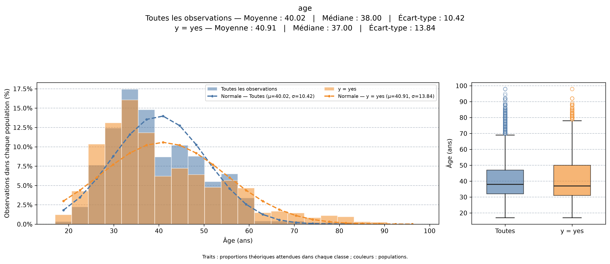

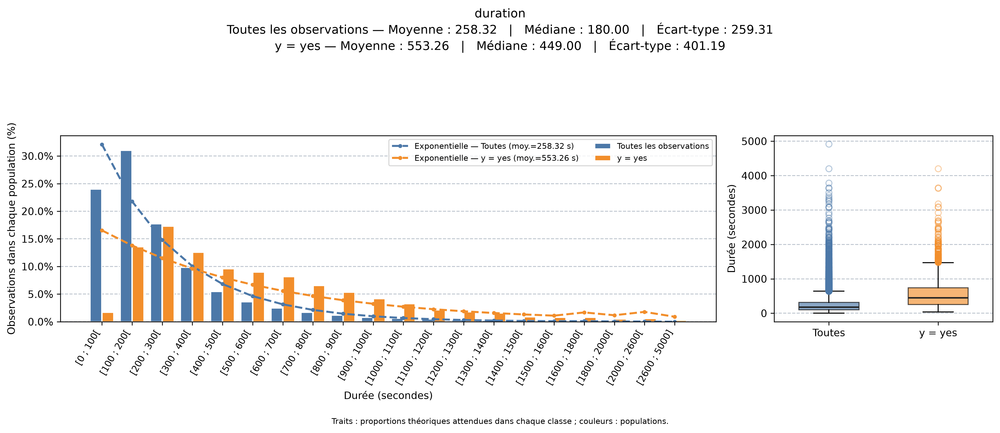

<details>
<summary>Paramètres des lois et autres distributions</summary>

| Variable | Ensemble | Souscripteurs |
|---|---|---|
| Âge — loi normale | Moyenne 40,02 ans ; écart-type 10,42 ans | Moyenne 40,91 ans ; écart-type 13,84 ans |
| Durée — loi exponentielle | Moyenne 258,32 secondes | Moyenne 553,26 secondes |

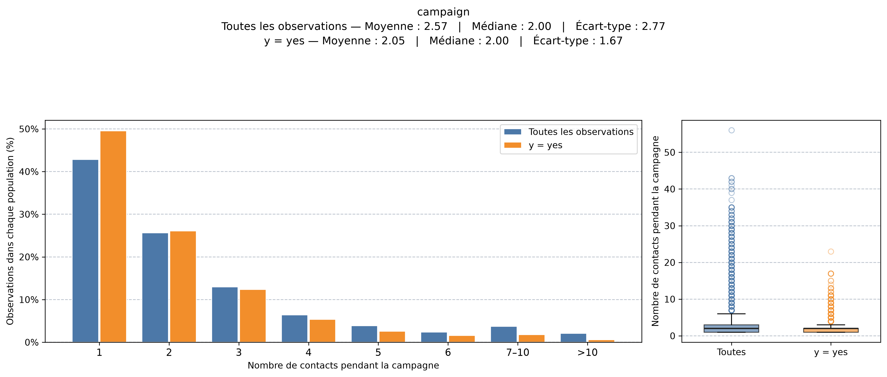

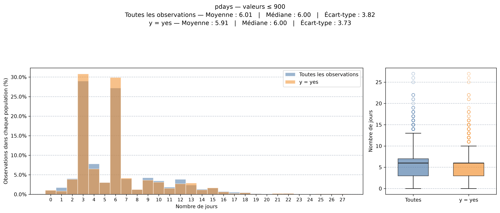

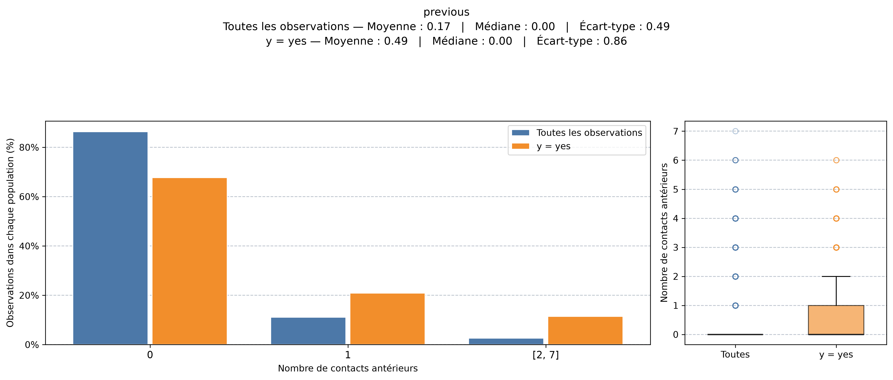


</details>

## Nettoyage et deux versions des données

| Étape commune | Lignes restantes |
|---|---:|
| Fichier brut | 41 188 |
| Retrait de 12 doublons stricts | 41 176 |
| Retrait des lignes avec `unknown` dans `job`, `marital`, `housing` ou `loan` | 39 791 |

La coïncidence de toutes les caractéristiques, notamment de la durée à la seconde près, m'a conduit à considérer les doublons comme des répétitions d'enregistrement. Cela reste une hypothèse, en l'absence d'identifiant client.

Pour les valeurs `unknown`, j'ai supposé que les lignes retirées ne représentaient pas des cas particulièrement extrêmes. La comparaison de leurs autres caractéristiques montre des distributions globalement proches de celles des lignes connues. Elle soutient visuellement mon hypothèse, sans démontrer que leur retrait est sans effet.

<details>
<summary>Comparaison des lignes avec et sans valeurs inconnues</summary>

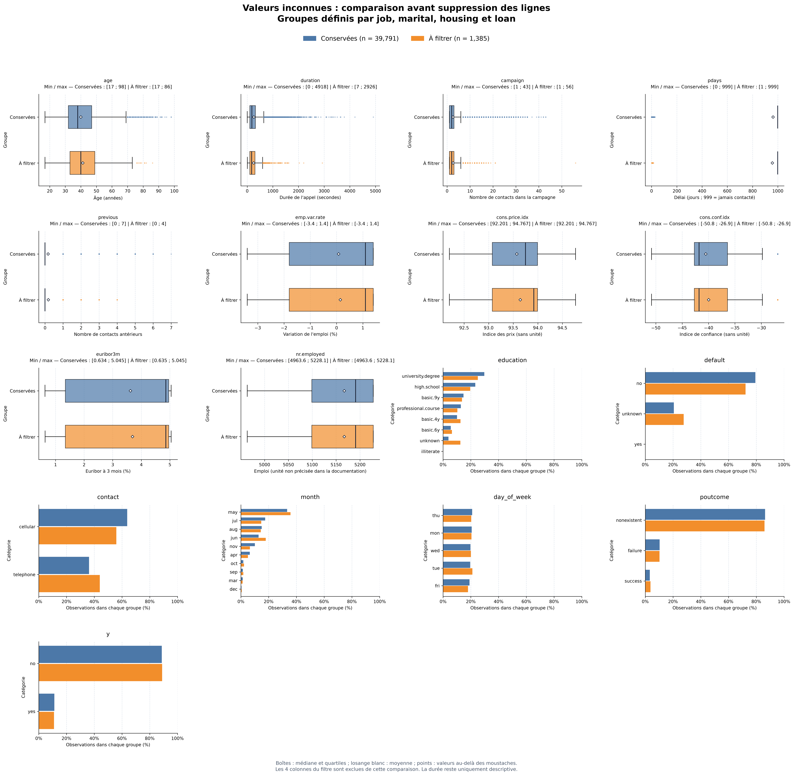

</details>

| Version | Traitement des `unknown` restants | Colonnes exclues du modèle |
|---|---|---|
| **Initiale, retenue** | `education` et `default` gardent `unknown` comme catégorie | `duration` |
| Simplifiée | Retrait des lignes contenant encore des `unknown` | `duration`, `pdays`, `day_of_week` |

La suppression de `pdays` est un choix expérimental : la ressemblance des distributions hors `999` ne prouve pas que la colonne apporte peu d'information. La simplification conserve toutes les variables économiques.

## Prétraitement et découpage

Les variables numériques sont standardisées avec `StandardScaler`, les catégories encodées avec `OneHotEncoder(handle_unknown="ignore")`, et la cible codée `no = 0`, `yes = 1`. Le prétraitement est ajusté sur l'entraînement de chaque pli de validation croisée (CV).

Le découpage conserve l'ordre chronologique : **70 % pour l'entraînement, 15 % pour la validation et 15 % pour le test**. La version simplifiée filtre les lignes à l'intérieur de ces mêmes périodes, sans déplacer leurs frontières.

| Ensemble | Version initiale | Version simplifiée |
|---|---:|---:|
| Entraînement | 27 853 | 20 249 |
| Validation | 5 969 | 4 806 |
| Test | 5 969 | Non retenu pour le test final |

La CV utilise `TimeSeriesSplit(n_splits=5)`. Ce protocole vise à apprendre sur le passé pour sélectionner des clients dans une période suivante. La proportion de souscripteurs évolue : environ **5,62 % à l'entraînement contre 10,62 % en validation** pour la version initiale, et **6,04 % contre 11,63 %** pour la simplifiée.

L'exploration descriptive a porté sur l'ensemble du fichier ; les scores prédictifs du test n'ont pas servi aux choix des modèles et paramètres.

## Modèles et apprentissage

| Modèle | Paramètres explorés par CV |
|---|---|
| Aléatoire | Sélection uniforme de 20 % des positions, sans remise |
| SVM RBF | `C` et `gamma` : `[0.01, 0.1, 1, 10]` ; `class_weight="balanced"` |
| SVM polynomial | `degree` : `[2, 3, 4]` ; `coef0` : `[10, 20]` ; `class_weight="balanced"` |
| Logistique classique | `alpha` : `[0.005, 0.01, 0.1, 0.5]` ; `n_iterations` : `[500, 1000, 2500, 5000]` |
| Logistique adaptée | Même grille que la classique |

Les deux régressions sont codées manuellement et intégrées aux pipelines. Toutes les CV choisissent les paramètres en maximisant la **précision parmi les 20 % sélectionnés**.

### Régression logistique adaptée

Pour rapprocher l'apprentissage de l'objectif de ciblage, je calcule le coût et le gradient uniquement sur les **20 % de probabilités les plus élevées**. Cette sélection est recalculée à chaque itération ; la régression classique utilise tous les clients.

Avec $p_i$ la probabilité prédite, $y_i$ la réponse réelle et $S_\theta$ les $m$ clients actuellement les mieux classés :

$$
J_{20}(\theta)=-\frac{1}{m}\sum_{i\in S_\theta}
\left[y_i\log(p_i)+(1-y_i)\log(1-p_i)\right].
$$

La minimisation de ce coût ne garantit pas directement une précision@20 % maximale : la CV évalue donc les paramètres sur la précision@20 %. Les paramètres démarrent à zéro et les égalités initiales sont départagées dans l'ordre des lignes.

## Évaluation et comparaison

Pour chaque ensemble, je sélectionne les $k=\lceil0{,}2n\rceil$ meilleurs scores parmi $n$ clients. Deux mesures résument les résultats :

$$
\text{Précision@20 \%}=\frac{\text{souscripteurs sélectionnés}}{k},
\qquad
\text{Rappel}=\frac{\text{souscripteurs sélectionnés}}{\text{tous les souscripteurs de l'ensemble évalué}}.
$$

Dans les matrices de confusion, « Oui » sur l'axe horizontal signifie **client sélectionné**. Les figures ci-dessous présentent à la fois l'entraînement et la validation.

### Version initiale, non simplifiée

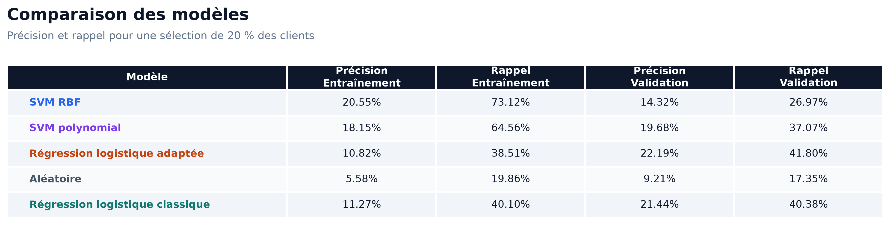

### Version simplifiée

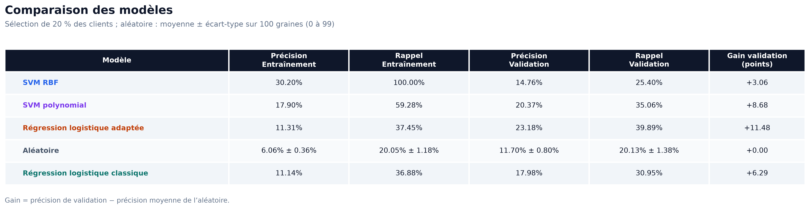

### Mon analyse des résultats

- Les modèles appris dépassent l'aléatoire sur la validation. La régression adaptée obtient les meilleurs scores parmi les modèles comparés.
- Avec les données initiales, les deux régressions sont proches : **22,19 % contre 21,44 % de précision**, et **41,80 % contre 40,38 % de rappel**, pour l'adaptée et la classique.
- Avec les données simplifiées, l'écart est plus marqué : **23,18 % contre 17,98 % de précision**, et **39,89 % contre 30,95 % de rappel**.
- Les SVM présentent des écarts importants entre entraînement et validation. Le rappel du RBF initial passe de **73,12 % à 26,97 %** ; celui du RBF simplifié atteint **100 % à l'entraînement**, puis descend à **25,40 %** en validation. J'y vois un signe fort de surapprentissage, dans un contexte où les populations évoluent aussi dans le temps.
- Les résultats des deux versions restent globalement proches, avec une dégradation plus nette pour la logistique classique. Les clients évalués diffèrent après filtrage : la comparaison statistique entre versions doit donc porter sur leurs clients communs.

<details>
<summary>Paramètres choisis et matrices de confusion</summary>

Les paramètres retenus changent pour le SVM RBF et la logistique classique. Les données et variables utilisées par la CV ayant changé, son classement des paramètres peut aussi changer ; cela ne suffit pas à expliquer entièrement les écarts de performance.

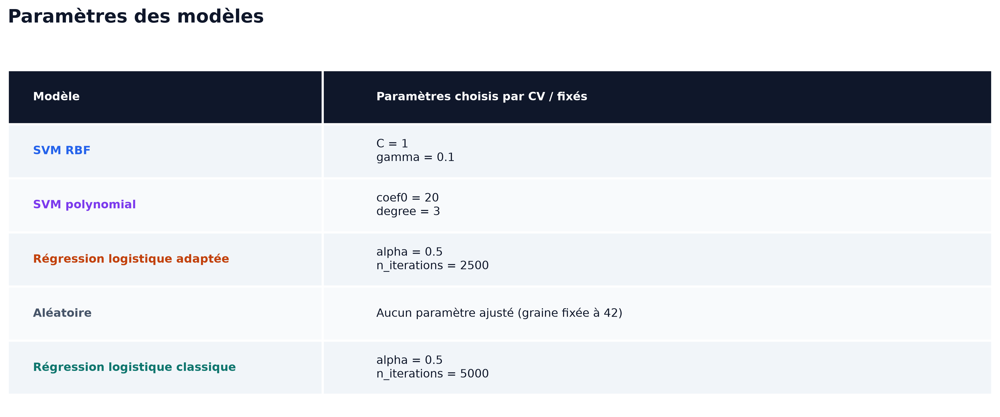

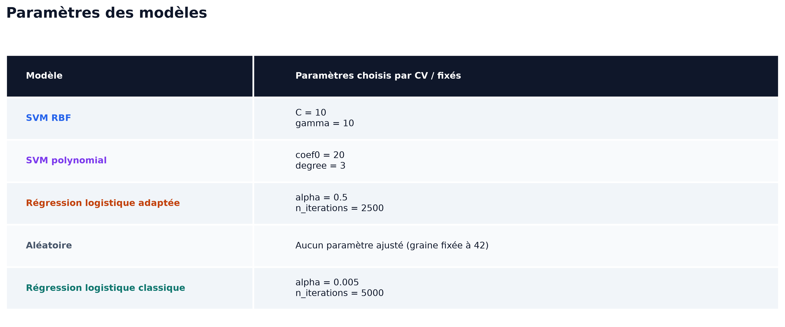

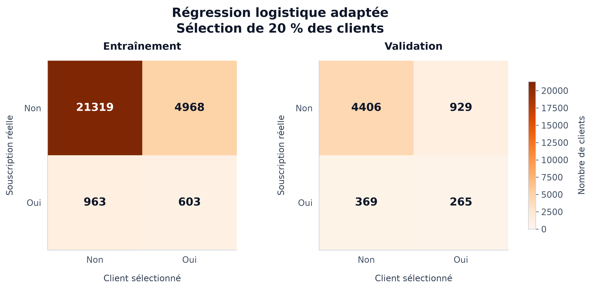

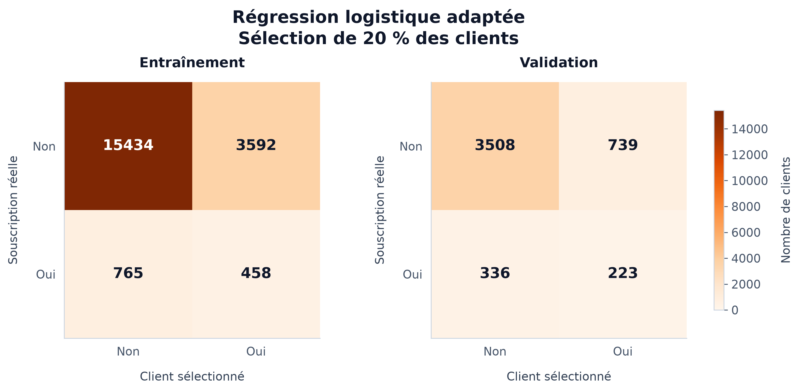


</details>

### Évolution des coûts

Le coût classique décroît puis se stabilise. Le coût adapté atteint une valeur basse au début, remonte puis tend vers un plateau, avec des fluctuations. Je n'approfondis pas davantage ce comportement ; un plateau ne démontre pas la proximité d'un minimum global.

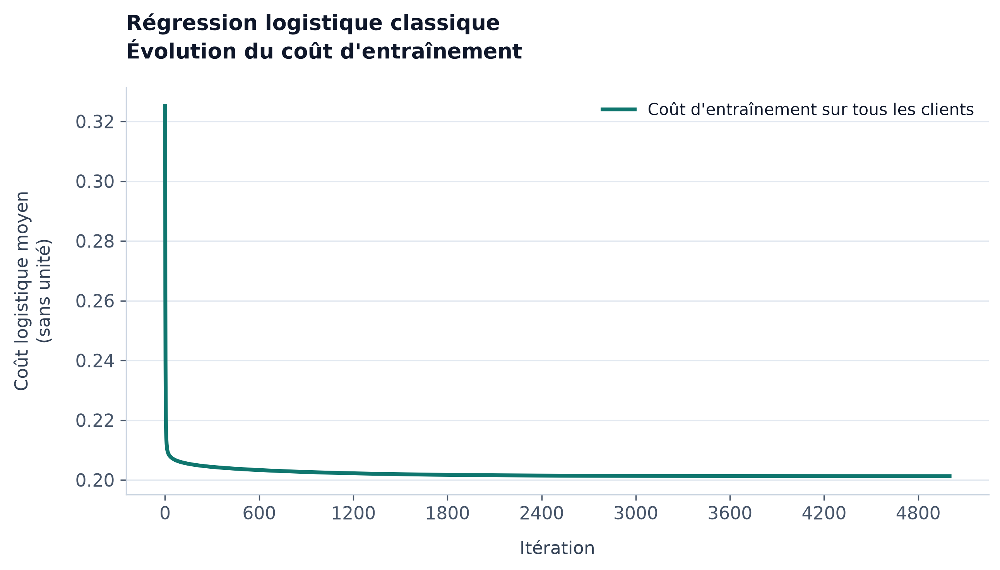

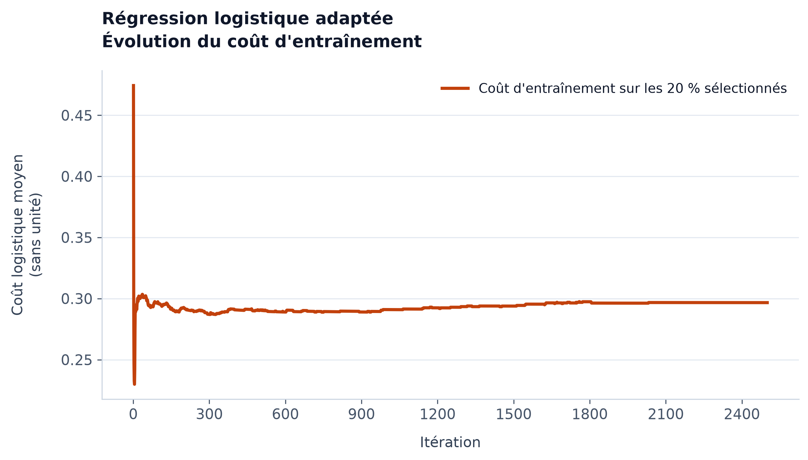

<details>
<summary>Coûts sur les données simplifiées</summary>

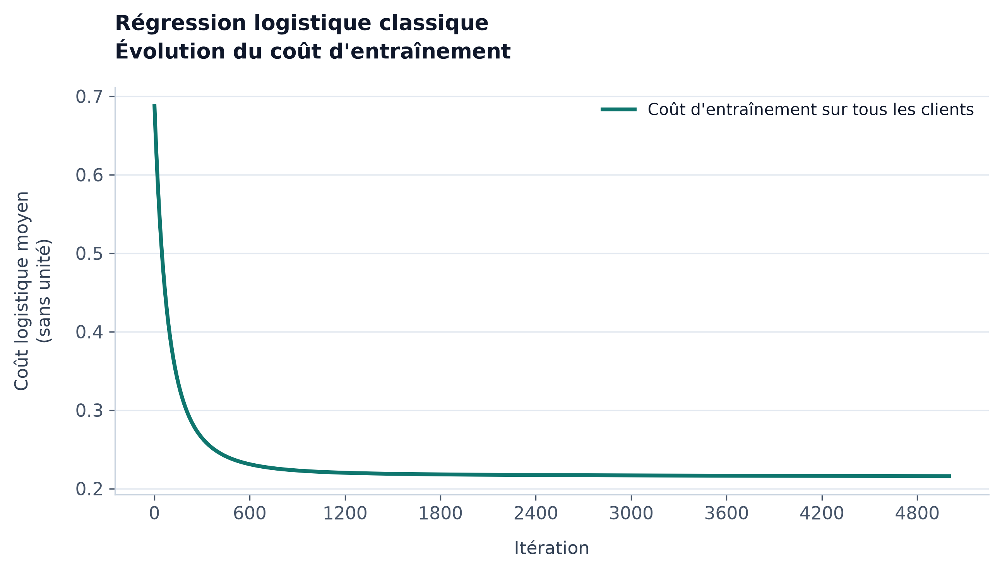

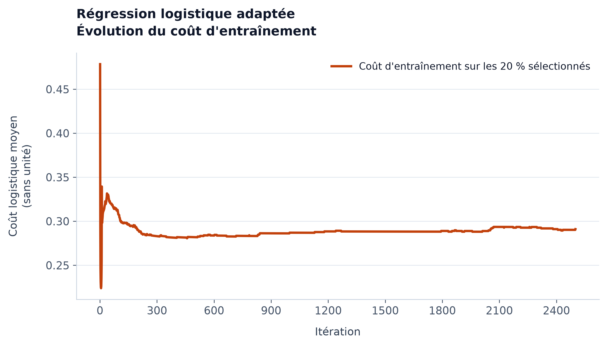

</details>

## Analyse statistique du gain

Je cherche à mesurer :

1. Le gain de chaque modèle appris face à l'aléatoire, dans chacune des deux versions.
2. Le gain de la régression adaptée simplifiée face à la non simplifiée, sur les mêmes clients.

Le **gain est la différence de précision en points de pourcentage**. Les prédictions sont recalculées depuis les données et modèles sauvegardés, avec le même quota pour chaque paire de sélections. Les **p-values sont présentées en pourcentage**.

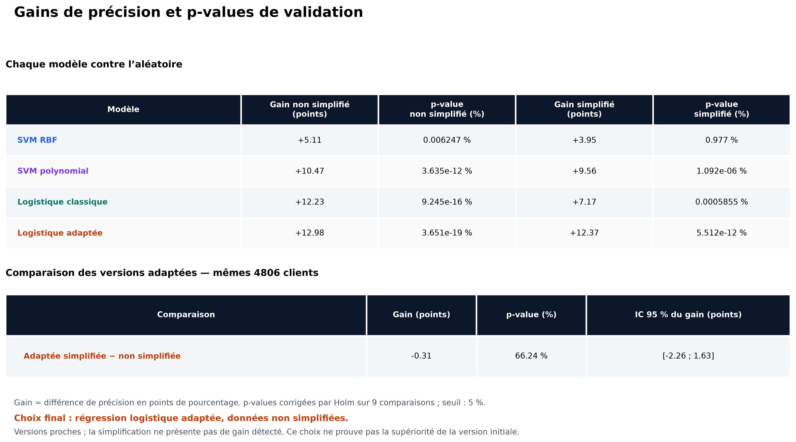

### Calculs utilisés

Sous $H_0$, il n'y a pas de gain positif face à la référence ; sous $H_1$, le gain est positif. Pour chaque vrai souscripteur, $d$ vaut +1 si seul le modèle le retrouve, −1 si seule la référence le retrouve, et 0 sinon.

Avec $M$ vrais souscripteurs et $k$ clients sélectionnés, le gain vaut $(M/k)\bar d$ et son erreur standard approchée vaut $(M/k)s_d/\sqrt M$, où $\bar d$ et $s_d$ sont la moyenne et l'écart-type des différences. Ces valeurs sont multipliées par 100 pour les exprimer en points.

La p-value repose sur le test binomial exact des désaccords, ou test de McNemar unilatéral. Une correction de Holm est appliquée aux **neuf comparaisons**, au seuil de **5 %**. Les intervalles à 95 % restent approximatifs et calculés séparément pour chaque comparaison.

<details>
<summary>Voir les calculs détaillés et les formules</summary>

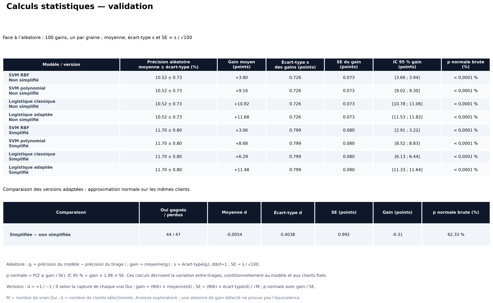

</details>

Cette analyse suppose des clients indépendants et reste exploratoire, puisque la validation a déjà servi aux choix. L'absence de gain détecté ne démontre pas l'équivalence ; la p-value n'est pas la probabilité que $H_0$ soit vraie.

## Choix final et test

Je retiens la **régression logistique adaptée sur les données non simplifiées**, avec **`alpha=0.5` et `n_iterations=2500`**. Les deux versions sont proches et la simplifiée est plus rapide à entraîner ; je conserve néanmoins l'initiale, sans affirmer sa supériorité statistique.

`Test.py` charge ce modèle déjà entraîné et l'applique au jeu de test initial, sans recherche de paramètres ni nouvel apprentissage. La figure produite rassemble la matrice de confusion, les mesures, les paramètres et la comparaison à l'aléatoire. **L'interprétation de ce résultat reste à compléter par mon analyse.**

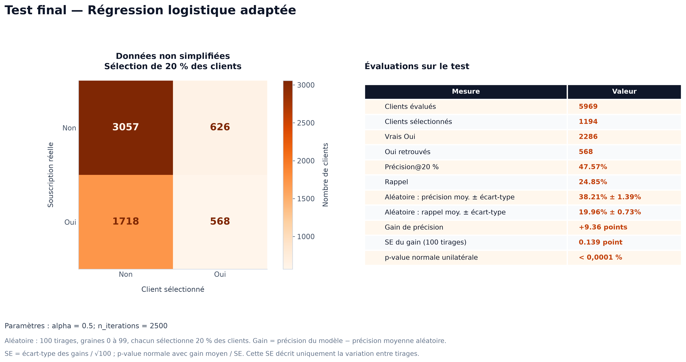

## Reproduire le projet

Placer le fichier UCI dans `Data/data.csv`, en conservant l'ordre des lignes. Depuis la racine du projet sous Windows :

```powershell
python -m venv .venv
.\.venv\Scripts\python.exe -m pip install -r Requirements.txt
cd Scripts
..\.venv\Scripts\python.exe Data.py
..\.venv\Scripts\python.exe Entrainement.py
..\.venv\Scripts\python.exe Evaluation.py
..\.venv\Scripts\python.exe EntrainementSimplifie.py
..\.venv\Scripts\python.exe EvaluationSimplifie.py
..\.venv\Scripts\python.exe TableauRecapitulatif.py
..\.venv\Scripts\python.exe Test.py
```

Les commandes se lancent depuis `Scripts/`. Les scripts d'entraînement sauvegardent `modeles_entraines.joblib` et `modeles_entraines_simplifies.joblib` ; s'ils existent déjà, les évaluations et statistiques les chargent directement. Les CV SVM peuvent prendre un temps important. Le test intervient après fixation du modèle et des choix de données.

<details>
<summary>Organisation des scripts</summary>

| Fichiers | Rôle |
|---|---|
| `Data.py`, `Pipeline.py` | Chargement, nettoyage, découpage, exploration et prétraitement |
| `SVM.py` | Définition des deux SVM et de leurs CV |
| `LogisticRegression.py`, `LogisticRegressionBase.py` | Régressions adaptée et classique, avec leurs CV |
| `Random.py` | Modèle de référence aléatoire |
| `Entrainement.py`, `EntrainementSimplifie.py` | Apprentissage et sauvegarde des deux versions |
| `Evaluation.py`, `EvaluationSimplifie.py` | Figures d'évaluation et paramètres retenus |
| `Statistiques.py`, `TableauRecapitulatif.py` | Calculs statistiques et figures dans `Resultats/Statistiques/` |
| `Test.py` | Évaluation finale du modèle retenu |

</details>

## Limites

- Les données concernent une seule banque et une période historique limitée ; elles ne garantissent pas les mêmes performances dans un autre contexte.
- Les filtres `unknown` changent la population couverte. Plusieurs modifications étant appliquées ensemble dans la version simplifiée, leur effet individuel n'est pas isolé.
- Le coût adapté ne garantit pas une précision@20 % maximale, ni un minimum global lorsqu'il se stabilise. Son quota arrondi à l'inférieur peut aussi différer d'un client de celui de l'évaluation, arrondi au supérieur.
- Les choix reposent sur une période de validation ; les tests statistiques ne modélisent pas les dépendances temporelles ou les éventuels clients répétés.
- L'entraînement, particulièrement la CV des SVM, demande des temps de calcul importants. Le RBF simplifié illustre aussi le risque de surapprentissage.
- Les gains étudiés mesurent des performances prédictives. Aucun bénéfice financier ni effet causal des appels n'est calculé.

## Auteur

Youness El Allali. Analyse, décisions expérimentales et implémentations manuelles des régressions ; assistance technique pour certaines parties du code, des graphiques et de la documentation.
